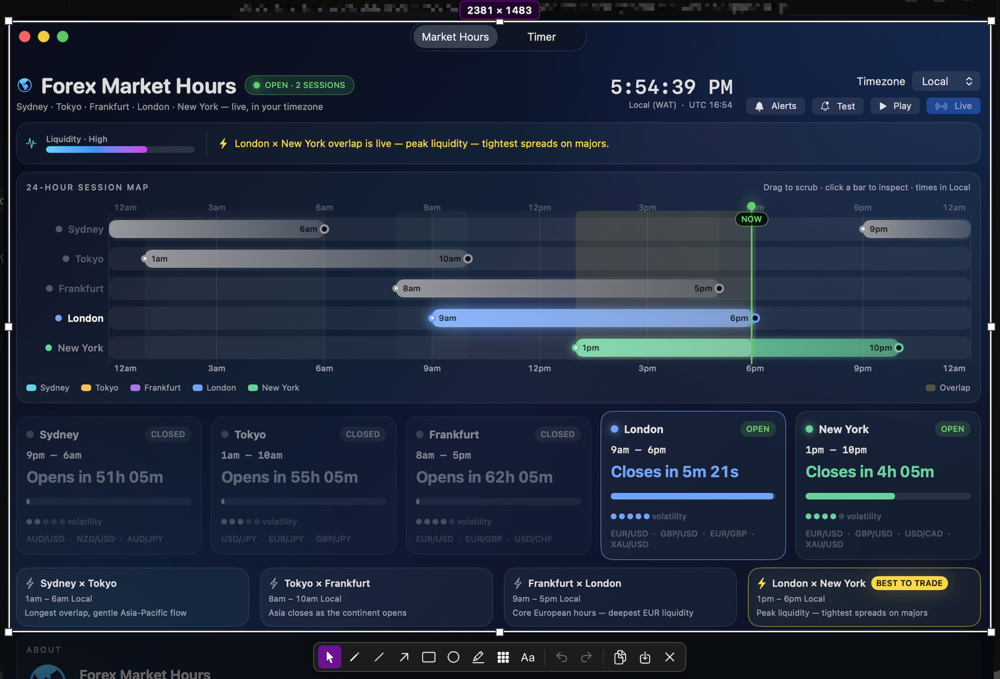

# Snapper

Fast screenshots with built-in annotations for macOS.



Snapper lives in your menu bar. Hit **Take Screenshot**, drag a region, annotate it
in place (arrows, shapes, text, pixelate…), then copy or save — no intermediate
windows, no friction.


## Features

- Region capture with a persistent, resizable selection (8 handles, move, arrow-key nudge)
- In-place annotations: pencil, line, arrow, rectangle, circle, marker, pixelate, text
- Attached toolbar + color/thickness panel, crosshair, magnifier loupe, size readout
- Copy to clipboard and auto-save to `~/Pictures/Snapper/` in one action
- Full-screen and single-window capture shortcuts
- In-app updates: downloads the new build, swaps it in and relaunches
- Menu-bar app — no dock icon

## Requirements

- macOS 14 or later
- Swift 6 toolchain (Xcode Command Line Tools is enough)

## Install

Download the DMG for your Mac from [Releases](https://github.com/Marvelxy/snapper/releases),
open it, and drag **Snapper** onto **Applications**. The disk image opens on a
proper install screen with the app icon and an Applications drop target.

Or build it yourself:

```sh
git clone https://github.com/Marvelxy/snapper.git
cd snapper
make install   # builds and copies Snapper.app to /Applications
make dmg       # or package build/Snapper-macOS.dmg with the install screen
```

Launch Snapper from `/Applications` (or `make run` to build and launch from `./build`).
On first capture macOS asks for **Screen Recording** permission: grant it in
System Settings → Privacy & Security → Screen & System Audio Recording, then
quit and relaunch the app.

> **Note:** builds are ad-hoc signed, so every rebuild changes the binary hash
> and macOS revokes the Screen Recording grant. After granting, relaunch with
> `make open` (no rebuild) instead of `make run`. See [CONTRIBUTING](CONTRIBUTING.md).

## Usage

| Action | How |
|---|---|
| Take screenshot | Menu bar → Take Screenshot |
| Select region | Drag; drag inside to move, drag handles to resize |
| Annotate | Pick a tool from the toolbar (`P` pencil, `D` line, `A` arrow, `R` rectangle, `C` circle, `M` marker, `B` pixelate, `T` text) |
| Colors / thickness | Side panel, toggled with `Space` |
| Copy | `Ctrl+C`, double-click, or `⏎` |
| Save | `Ctrl+S` |
| Undo / redo | `Ctrl+Z` / `Ctrl+Shift+Z` |
| Select all | `Ctrl+A` |
| Quit editor | `Esc` |

You can also run a headless self-check (useful after granting permission):

```sh
build/Snapper.app/Contents/MacOS/Snapper --diagnose
```

## Project layout

```
Sources/Snapper/
  SnapperMain.swift        Entry point (+ --diagnose mode)
  AppDelegate.swift        Menu actions, capture pipeline, result handling
  Capture/                 ScreenCaptureKit wrappers
  Storage/                 Saving to ~/Pictures/Snapper
  Support/                 Permissions, image utilities, errors, diagnostics
  UI/                      Overlay editor, toolbar, panels, windows
```

## Contributing

See [CONTRIBUTING.md](CONTRIBUTING.md).

## License

GPL-3.0 — see [LICENSE](LICENSE).

© 2026 Marvelous Akpotu — [github.com/Marvelxy](https://github.com/Marvelxy) — still4marvelous@gmail.com
